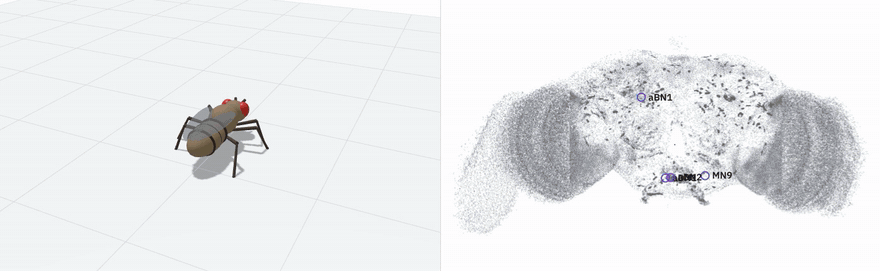

# Neuropil

A fruit fly brain where every neuron is an actor and every spike is a message.

The wiring is from the [FlyWire](https://flywire.ai) connectome, and the neuron model is from [Shiu et al. (Nature, 2024)](https://doi.org/10.1038/s41586-024-07763-9).

It works by stimulating the sugar-sensing neurons so the signal travels from the fly's taste neurons to the motor neurons that make it feed. The actor version spikes identically to a plain array simulator run on the same brain.

